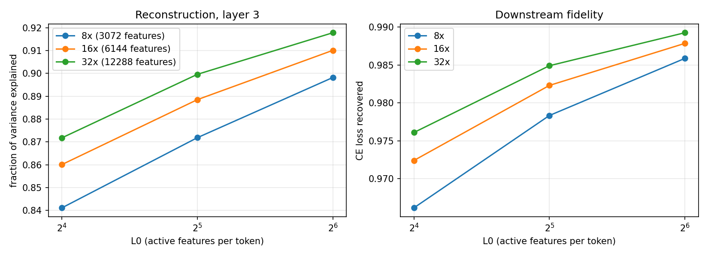

# Results: SAE sweep on tiny-gpt-sae (layer 3 residual stream)

Run date: 2026-10-10, on a Kaggle Tesla T4. Raw numbers are in
[`sae_sweep_results.json`](sae_sweep_results.json); everything below comes from that file
and the feature inspector output for the `16x_k32` SAE.

## Setup

- Base model: the ~20M-parameter tiny-gpt-sae GPT trained on TinyStories (15,000 steps,
  val loss 1.58).
- SAEs: TopK sparse autoencoders on the layer-3 residual stream (d_model = 384), trained
  for 5,000 steps each.
- Sweep: expansion factor {8, 16, 32} x k (active features per token) {16, 32, 64}.
- Metrics, on held-out validation tokens:
  - **FVE**: fraction of variance of the activations explained by the reconstruction.
  - **CE loss recovered**: `(CE_zero - CE_sae) / (CE_zero - CE_clean)`, where the SAE
    reconstruction (or a zero vector) is spliced back into the forward pass.
    CE_clean = 1.582, CE_zero = 7.856.
  - **Dead**: features that never fired on the eval set. **Dense**: features firing on
    more than 10% of tokens.

## Sparsity vs. fidelity

| SAE | features | L0 | FVE | CE with SAE | CE loss recovered | dead | dense | train time |
|---|---:|---:|---:|---:|---:|---:|---:|---:|
| 8x_k16  | 3,072  | 16 | 0.841 | 1.794 | 96.6% | 5     | 6  | 184 s |
| 8x_k32  | 3,072  | 32 | 0.872 | 1.718 | 97.8% | 1     | 17 | 172 s |
| 8x_k64  | 3,072  | 64 | 0.898 | 1.671 | 98.6% | 0     | 56 | 176 s |
| 16x_k16 | 6,144  | 16 | 0.860 | 1.755 | 97.2% | 100   | 6  | 298 s |
| 16x_k32 | 6,144  | 32 | 0.888 | 1.693 | 98.2% | 6     | 15 | 302 s |
| 16x_k64 | 6,144  | 64 | 0.910 | 1.658 | 98.8% | 3     | 40 | 307 s |
| 32x_k16 | 12,288 | 16 | 0.872 | 1.732 | 97.6% | 1,112 | 5  | 539 s |
| 32x_k32 | 12,288 | 32 | 0.900 | 1.677 | 98.5% | 30    | 16 | 539 s |
| 32x_k64 | 12,288 | 64 | 0.918 | 1.649 | 98.9% | 20    | 38 | 539 s |

Observations:

- Both fidelity metrics improve monotonically with width and with k; no configuration
  is off the frontier.
- Every SAE recovers at least 96.6% of the CE loss gap, yet FVE tops out at 0.918. The
  unexplained ~8–16% of variance matters little to next-token loss, a gap worth
  investigating (e.g. whether it lives in a few high-norm directions).
- Dead features grow sharply with width at low k (1,112 of 12,288, i.e. 9%, for
  32x_k16), and dense features grow with k (56 for 8x_k64). 16x_k32 is a reasonable
  middle point: 98.2% loss recovered with 6 dead and 15 dense features, and is the SAE
  used for feature review.

## Feature review (16x_k32)

Method: the inspector dumped the top-activating validation contexts for features 0–299
(the first 300 by index, not cherry-picked). I read the top ~12 contexts for features
0–33, every one of which was alive and non-dense (firing frequency 0.08%–3.2% of
tokens). A label is given only when the top contexts clearly agree; otherwise the
feature is marked unclear. These are labels from top activations only — they say what
the feature responds to most strongly, not that it is monosemantic across its whole
activation range, and no causal (ablation/steering) checks have been done yet.

Example notation: the activating token is in `[[ ]]`.

| feature | fire freq | label | example |
|---|---:|---|---|
| 0  | 0.16% | " go" after "let's" | `Now, let's[[ go]] home and` |
| 1  | 0.43% | " to" after "the X thing" (moral judgments) | `That was the wise thing[[ to]] do.` |
| 2  | 0.93% | period ending "showed it to her mom/friends" | `showed the pearl to her mommy[[.]] Her mom` |
| 3  | 0.30% | " his" after "loved to ride" | `Timmy loved to ride[[ his]] bike` |
| 4  | 0.14% | " to" after "use it" (instrumental purpose) | `You can use it[[ to]] fight dragons` |
| 5  | 0.14% | " you" in "What do you ...?" | `What do[[ you]] think he` |
| 6  | 0.23% | " and" after "felt/got scared" | `Timmy got scared[[ and]] ran inside` |
| 7  | 0.17% | comma after "looked everywhere" (sets up "but") | `He looked everywhere[[,]] but he` |
| 8  | 0.35% | " heard" after "Suddenly, they/she" | `Suddenly, they[[ heard]] a loud` |
| 9  | 0.41% | possessive after "in" (in her head/journal/hands) | `write in[[ her]] journal` |
| 10 | 2.02% | location preposition after "X and Y liked to play" at story start | `Tom and Lily liked to play[[ in]] the park` |
| 11 | 0.16% | preposition after "cared/proud" | `we are proud[[ of]] you` |
| 12 | 0.89% | sentence-initial He/She after a sentence about liking or thinking | `very cool and exciting.[[ She]] wanted to` |
| 13 | 0.74% | sentence-initial He/She after "wanted ... too" | `wanted to try the big berry too.[[ She]] saw` |
| 14 | 0.30% | " to"/" of" after "way" | `the best way[[ to]] make friends` |
| 15 | 3.19% | " was" after "it" in story transitions ("But then it was") | `But then it[[ was]] time for` |
| 16 | 1.48% | " they" after "became (best) friends" | `became best friends.[[ They]] played` |
| 17 | 0.49% | sentence-initial "And" | `made a new friend.[[ And]] so,` |
| 18 | 0.09% | the word "rest" | `stopped to take a[[ rest]] in the` |
| 19 | 0.30% | " even" after "learned that" (moral of the story) | `He learned that[[ even]] when things` |
| 20 | 0.29% | possessive after "brush" | `brush[[ your]] teeth` |
| 21 | 0.08% | " town" in "in a small town" | `Once upon a time, in a small[[ town]], there` |
| 22 | 0.54% | opening quote after an angry character "says," | `She was very angry. She said,[[ "]]Lily` |
| 23 | 0.18% | " what" after "wondered" | `She wondered[[ what]] it was` |
| 24 | 0.93% | " not" after "do/did" in repetitive negation | `They did not laugh. They did[[ not]] smile.` |
| 25 | 0.20% | " and" after "nodded" | `Lily nodded[[ and]] smiled.` |
| 26 | 0.08% | " breath" in "took a deep breath" | `Lily took a deep[[ breath]] and tried` |
| 27 | 0.33% | "Who" opening a question ("Who's there?") | `"[[Who]]'s there` |
| 28 | 0.20% | " pieces" after "into (small)" | `It broke into[[ pieces]].` |
| 29 | 0.32% | "Once" right after `<\|endoftext\|>` (new story) | `<\|endoftext\|>[[Once]] upon a` |
| 30 | 0.60% | mostly the name " Jack" (one top example is " Jane") | `[[ Jack]] was scared` |
| 31 | 2.67% | unclear: tokens at the start of a reply to an exclamation ("Wow", quote, comma) | `"Wow[[,]] that's` |
| 32 | 0.57% | " the" after "near"/"in" in location phrases | `a big rock near[[ the]] fence` |
| 33 | 1.08% | unclear: weak (max act 2.8) verb after a He/She subject (told/showed/tells) | `She[[ showed]] her daughter` |

Takeaways:

- 32 of 34 reviewed features have a clear top-activation pattern; 2 are unclear.
- Most clear features are **context-dependent token features**: the same surface token
  (" to", " and", " his", " the") is split into separate features by what precedes it
  — e.g. " to" in "the wise thing to do" (F1), "use it to" (F4) and "best way to" (F14);
  " and" after "scared" (F6) vs. after "nodded" (F25).
- A few track **story structure** rather than local syntax: the "Once" that starts a new
  story (F29), "Suddenly, they heard" plot turns (F8), "learned that even..." morals
  (F19), and "became best friends. They..." endings (F16).

## Causal tests: ablation and steering (16x_k32, layer 3)

Script: `scripts/causal_experiments.py`, run on a Kaggle T4. Raw outputs are in [`docs/causal/`](causal/).
For 8 hand-labelled features, the feature was zero-ablated at 150 randomly sampled positions where it fires
(not just top activations), and the change in the next-token distribution was measured. As a matched control,
at the same positions a *different* active feature with the closest activation was ablated instead.
A sanity check ablated each feature where it is inactive (max KL ≤ 0.001, so the hook is clean).

| feature | label | KL target (mean / median) | KL matched control (mean / median) | top dropped tokens |
|---|---|---|---|---|
| 1 | " to" after "the X thing" | 0.011 / 0.002 | 0.027 / 0.003 | ` do`×27, ` them`×11, ` make`×8 |
| 4 | " to" after "use it" | 0.015 / 0.002 | 0.021 / 0.003 | ` make`×25, ` of`×18, ` a`×12 |
| 14 | " to"/" of" after "way" | 0.005 / 0.001 | 0.011 / 0.002 | `.`×21, ` the`×18, ` to`×17 |
| 29 | "Once" starting a new story | 0.000 / 0.000 | 0.003 / 0.000 | ` upon`×143, ` there`×6 |
| 8 | " heard" after "Suddenly, they" | 0.013 / 0.002 | 0.009 / 0.001 | ` little`×48, ` a`×30, ` voice`×26 |
| 19 | " even" after "learned that" | 0.007 / 0.001 | 0.015 / 0.002 | `,`×19, ` we`×12, `.`×9 |
| 22 | opening quote after angry "said," | 0.012 / 0.004 | 0.013 / 0.003 | `That`×31, `No`×16, `What`×15 |
| 26 | " breath" in "took a deep breath" | 0.007 / 0.001 | 0.011 / 0.001 | ` and`×46, `.`×10, ` little`×9 |

**Ablation is essentially a null result.** Removing any single feature barely moves the next-token
distribution (median KL 0.001–0.004 nats), and no target feature has a larger effect than its matched
control; for 6 of 8 the control's mean KL is actually higher. With 32 features active per token, the model's
prediction is evidently robust to losing any one of them, so single-feature zero-ablation is not a sensitive
test of these labels. The *direction* of the effect is often label-consistent even though the size is tiny:
feature 29 ("Once") lowers ` upon` in 143/150 cases, the " to" features (1, 4) mostly lower infinitive verbs
(` do`, ` make`), feature 8 lowers things one hears (` voice`, ` noise`, ` loud`), and feature 22 lowers
quote openers (`That`, `No`, `What`). Feature 19's label is not supported by this test.

**Steering is clearer for some features.** Each feature was clamped to 1× and 3× its max observed activation at
every position while generating 60 tokens from three prompts (one sample per setting, temperature 0.8, so this
is qualitative). At 3×:
- Feature 26 (deep breath) takes over generation on every prompt: "it would breath from deep down… breath, be calm".
  Strong support for the label.
- Feature 8 (" heard") pushes toward sounds/voices on 2 of 3 prompts ("followed a voice… a little voice… voice voice voice").
  Supports a "something heard" reading.
- Feature 1 mildly shifts text toward "do / make" constructions ("She decided to do her special…", "make them a treat").
- Features 4, 14, 19, 22, 29 show no clear label-specific effect; text just degrades at 3×.
  At 1× all features are hard to distinguish from baseline sampling noise.

Takeaway: 2 of 8 labels (26, 8) get clear causal support from steering, a few more get weak directional
support from ablation, and the rest are unconfirmed. A better next test would ablate groups of related
features or use activation patching on the specific tokens the label predicts, and sample several
generations per steering setting.

## Next steps

- Causal checks: ablate/steer a few of the clear features and measure the effect on
  next-token predictions.
- Automated labeling over all 6,144 features, spot-checked against the hand labels here.
- Use the saved early checkpoints to study when these features emerge during training.
